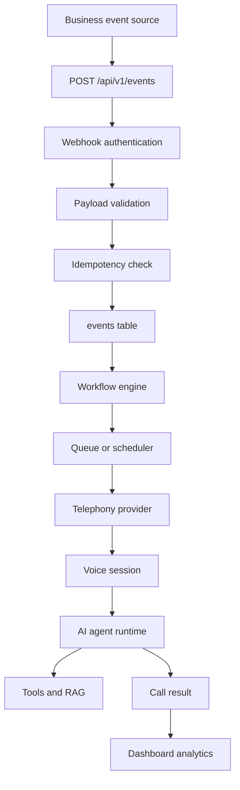
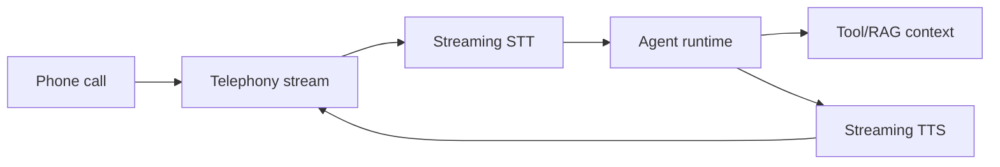

# SwarVox AI Architecture

## 1. Final Architecture

SwarVox is a modular SaaS platform centered on an event engine. Business systems send signed events into SwarVox. The event engine validates and stores those events, maps them to tenant-specific workflows, and schedules actions. Outbound calls are executed asynchronously through a telephony abstraction. Inbound calls enter through the same telephony layer, then attach to a business, customer, agent, tools, and knowledge context.

The production architecture separates FastAPI APIs, PostgreSQL, Redis queueing, event processing, workflow orchestration, scheduling, telephony adapters, voice sessions, AI agent runtime, controlled backend tools, RAG, analytics, and dashboard UI.

## 2. Component Responsibilities

- Backend API: REST/webhook endpoints, validation, tenant context, and dashboard data.
- Event Engine: receive, validate, deduplicate, persist, route, retry, and status-track events.
- Workflow Engine: match tenant events to configured actions, timing, agents, and objectives.
- Scheduler: run immediate, delayed, reminder, callback, and retry jobs with business-hours rules.
- Telephony Service: provider-neutral outbound and inbound call operations.
- Voice Pipeline: low-latency STT, AI agent runtime, TTS, and streaming audio transport.
- Agent Runtime: conversation state, policies, tool calling, RAG grounding, and escalation decisions.
- Tool Service: controlled functions with validation, permission checks, audit logs, and typed errors.
- RAG Service: document ingestion, chunking, embeddings, retrieval, and grounded answers.
- Dashboard: operational visibility for calls, events, customers, agents, workflows, and settings.

## 3. Data Flow



## 4. Database Schema

Core tables: `users`, `businesses`, `agents`, `customers`, `events`, `workflows`, `calls`, `call_events`, `conversations`, `messages`, `appointments`, `webhooks`, `tools`, `tool_executions`, `knowledge_documents`, `knowledge_chunks`, `tickets`, `audit_logs`, and `subscriptions`.

Every tenant-scoped table carries `business_id`, timestamps, indexes for dashboard queries, and soft deletion where appropriate. Idempotency is enforced with unique constraints, not application memory.

## 5. API Design

Phase 1 endpoints:

- `GET /health`
- `POST /api/v1/events`
- `GET /api/v1/events`
- `GET /api/v1/events/{event_id}`
- `GET /api/v1/calls`
- `GET /api/v1/calls/{call_id}`
- `POST /api/v1/demo/lead`

Later phases add customers, appointments, call control, knowledge documents, tool execution, telephony inbound webhooks, provider status callbacks, API keys, and admin settings.

## 6. Event Model

Events include business identity, type, source, external event ID, idempotency key, customer payload, domain payload, status, validation errors, and correlation ID.

Statuses: `RECEIVED`, `VALIDATED`, `QUEUED`, `PROCESSING`, `CALLING`, `COMPLETED`, `FAILED`, `RETRYING`, `CANCELLED`.

The event engine is idempotent through `(business_id, idempotency_key)`.

## 7. Workflow Model

```json
{
  "trigger": "appointment.created",
  "action": "outbound_call",
  "agent_id": "appointment_agent",
  "timing": "immediate",
  "enabled": true
}
```

Phase 1 supports immediate outbound call workflows. Phase 3 expands timing into durable scheduled jobs and retry policies.

## 8. Voice Pipeline



Phase 1 uses a mock provider and generated summaries so the event-to-call path can be tested safely. Real bidirectional audio streaming arrives after the service boundaries are stable.

## 9. Technology Choices

- FastAPI: typed validation, async support, and clean API ergonomics.
- PostgreSQL: durable relational store, tenant isolation, constraints, and future `pgvector`.
- SQLAlchemy: explicit models and migration-friendly schema ownership.
- Redis: queue and scheduler foundation.
- React, TypeScript, Vite, Tailwind: typed operational dashboard with fast local iteration.
- Provider-neutral AI and telephony interfaces: replace vendors without rewriting core business logic.

## 10. Development Phases

- Phase 1: backend foundation, PostgreSQL models, event API, one workflow, mock outbound provider, basic dashboard/form.
- Phase 2: RAG, tool calling, customer memory, call summaries, appointment tools, human transfer.
- Phase 3: workflow builder, scheduler, retry system, inbound calls, webhooks, multiple agents.
- Phase 4: authentication, tenant hardening, rate limiting, monitoring, audit logs, retention, deployment.
- Phase 5: onboarding, API key management, subscriptions, billing, usage limits, multiple telephony providers.
